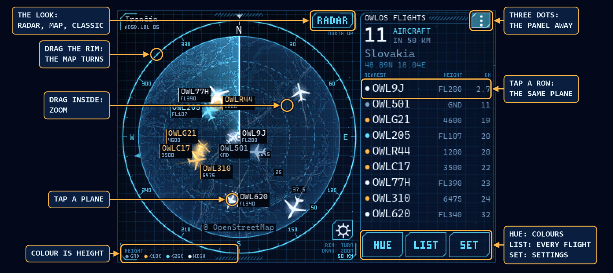
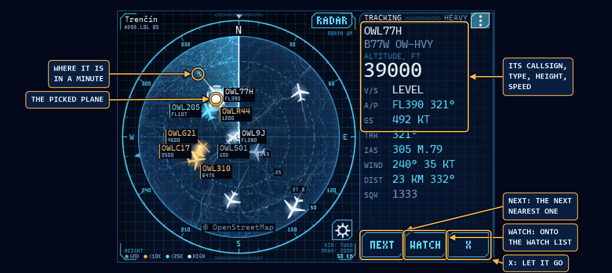
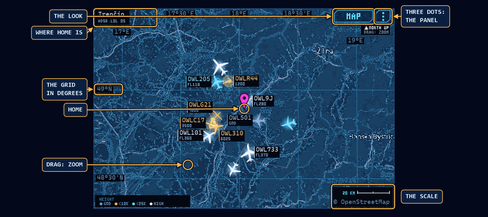
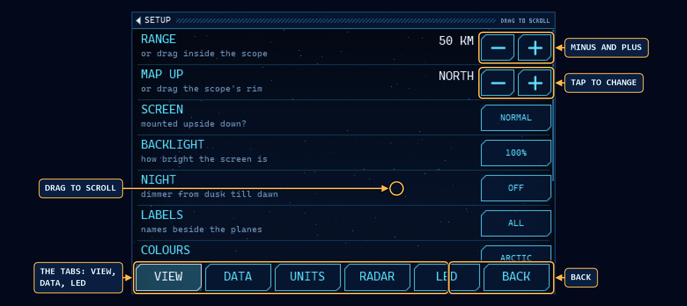
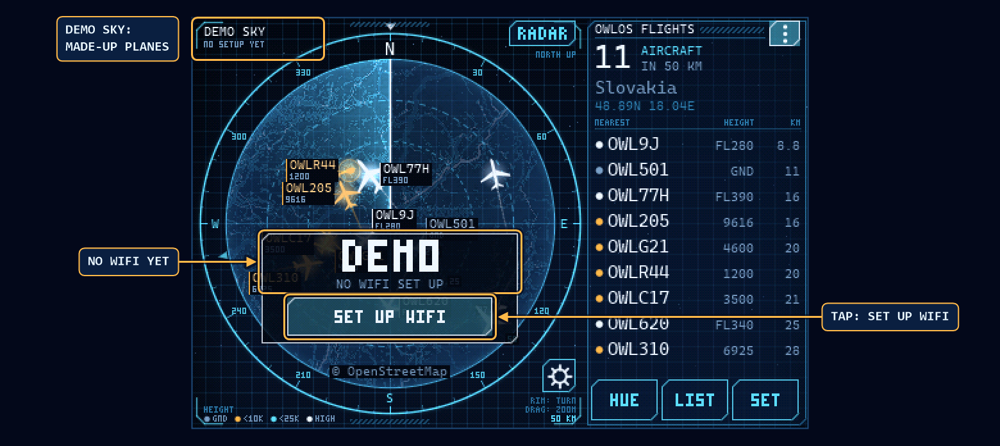
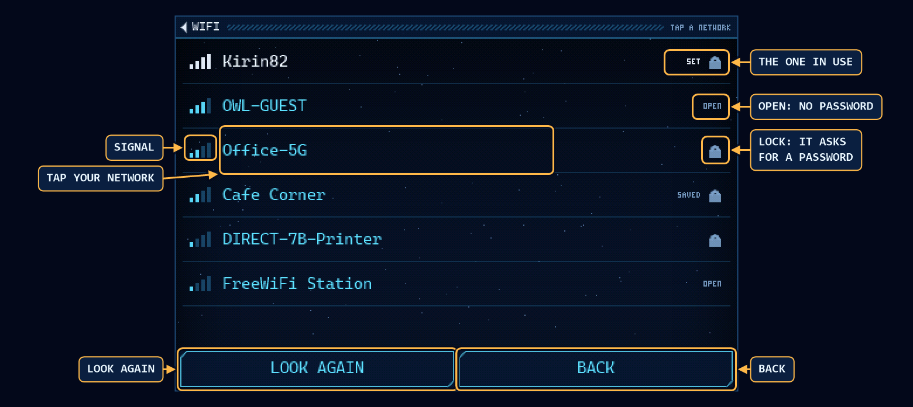
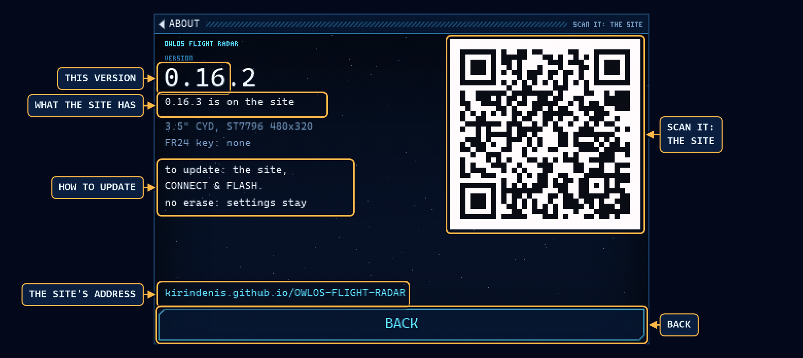
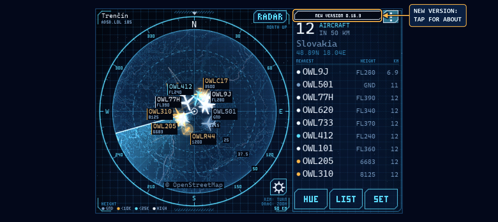
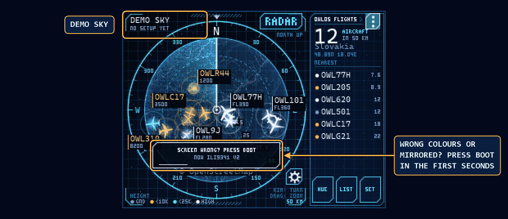
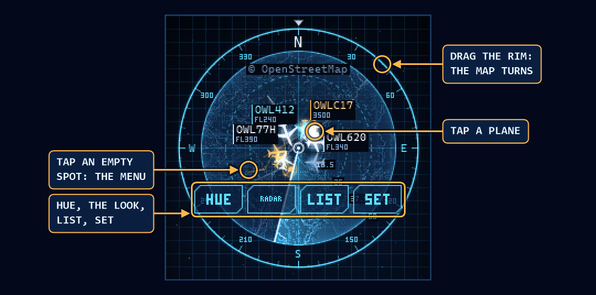

# OWLOS Flight Radar

**Flash it from the browser: [kirindenis.github.io/OWLOS-FLIGHT-RADAR](https://kirindenis.github.io/OWLOS-FLIGHT-RADAR/)**

**Try it in your browser: [the radar in a page](https://kirindenis.github.io/OWLOS-FLIGHT-RADAR/radar/)**, a demo sky, or your own board's planes over the USB cable.

Questions, ideas, a photo of your board: [our group on Facebook](https://www.facebook.com/groups/OWLOS).

The planes around your home on a small ESP32 board with a screen. Each plane is a silhouette turned the
way it flies, coloured by its height, with a trail behind it. Tap one for its callsign, type, height and
speed. The planes come from the free community ADS-B networks, or from Flightradar24 if you have a key.
The map under them comes from OpenStreetMap.

**An Open Skills project.** Next to the code we give away the skills that built it, in [`skills/`](skills/):
the chips and every board, one file each, the panels, buses and touch chips, the graphics, the memory and
the watchdogs, flashing and settings, the web services. Every fact says how sure it is: measured on a real
board, built, read from docs, or reasoned. Bring your own AI agent: [`AGENTS.md`](AGENTS.md) tells it where
to start, and it starts where we stopped.

**Contents:** [What it does](#what-it-does) · [The boards](#the-boards) · [Flash it](#flash-it) ·
[Stable or beta](#stable-or-beta) · [WiFi and home](#wifi-and-home) · [Where to tap](#where-to-tap):
[the radar](#the-radar), [a plane picked](#a-plane-picked), [the map](#the-map), [the weather](#the-weather),
[weather warnings](#weather-warnings), [LIST](#list), [SET](#set), [the demo](#no-wifi-yet-the-demo),
[the networks](#the-networks), [the password](#the-password), [home](#home), [watch](#watch),
[the LED](#the-led), [ABOUT and a new version](#about-and-a-new-version),
[the 2.8" CYD's screens](#the-28-cyd-which-screen), [the round glass](#the-round-glass) ·
[If it ever stands still](#if-it-ever-stands-still) · [The moving layer](#the-moving-layer) ·
[Build it yourself](#build-it-yourself) · [The site's console](#the-sites-console) ·
[The USB console](#the-usb-console) · [Data and licences](#data-and-licences)

## What it does

- A radar scope with a sweeping beam over the map, or a plain square map, or the same map in
  OpenStreetMap's own colours, or the next 24 hours of the weather on the radar's dial. One button goes
  round them.
- The planes glide. Between two positions the board flies each plane on by itself, round its curve in a
  turn, and slides it onto the next position instead of jumping, its nose turning with it.
- A map made to be read on a small screen: water and towns have a light edge, every road and stream runs
  whole, and the names of towns and villages are light on the dark looks.
- Real distances and bearings round your home. Drag the rim to turn the map the way the screen stands,
  drag inside to zoom from 2 to 250 km (or nautical miles, or miles).
- The nearest planes in a panel, every flight in a list, the picked one with all it is known about it.
- Five colour themes, the colour of a plane always says its height.
- Next to an airport the planes parked and taxiing there can be hidden: SET, ON GROUND.
- A watch list of up to 8 planes: the board picks one when it comes in range, and says when one takes
  off or lands anywhere in the world.
- The RGB LED on the back of the 2.8" and 3.5" CYD lights for what happens: an emergency squawk round
  home, a watched plane coming, taking off or landing, no data. Each one on or off.
- Without WiFi it flies a made-up demo sky and says DEMO in big letters. The WiFi and the home are set
  on the touch screen itself, or from the site over the USB cable.
- It knows its version and finds out by itself when the site has a newer one: a small note on the
  screen opens ABOUT, with a QR code to the site. What changed in each version: [CHANGES.md](CHANGES.md).
- The site runs your boards over the USB cable: each board's screen live in the page, every setting, and
  a console where one line sets a look, a home or the light on all of them at once.
- The map pictures are downloaded once and kept in the board's flash: a range it has shown comes back
  at once, even without WiFi.

## The boards

- **2.8" CYD** ("cheap yellow display", ESP32-2432S028R): ESP32, 320x240, resistive touch. Sold with three
  different screens, one build fits them all (see below). Both cores draw the screen.
- **3.5" CYD** (ESP32-3248S035, R or C version): ESP32, ST7796 480x320, resistive or capacitive touch. The
  second core draws half the radar and the weather.
- LCDWIKI's ESP32-32E boards, also sold by Elegoo: the 2.8" E32R28T takes the 2.8" CYD build and the
  3.5" E32R35T the 3.5" one, the screen and the touch are on the same pins. Only the LED's red is on
  another pin, see The LED.
- **2.8" LCDWIKI ES3C28P**: ESP32-S3, ILI9341V 320x240, capacitive touch (FT6336). Its USB-C is the S3's
  own. New, not run on one here yet: the pins come from LCDWIKI's schematic.
- **2.8" NM-CYD-C5**: the CYD's form on an ESP32-C5, ST7789 320x240, resistive touch, two USB-C ports
  (either works). New, not run on one here yet: the pins come from its maker's schematic.
- **2.8" ZLX-ESP32-2**: an ESP32-C5 board with a socket for an outside antenna, ST7789 320x240, resistive
  touch, one USB-C. Experimental, never run on one here: the pins come from its maker's pin list and
  factory test. Not the NM-CYD-C5's pins: that build leaves its screen dark. Its speaker and its green
  LED are not used.
- **2.8" Elecrow CrowPanel Advance** (the 2.8" HMI ESP32 AI display): ESP32-S3, ST7789 320x240 IPS,
  capacitive touch (FT6336), two USB-C ports (either works). New, not run on one here yet: the pins
  come from Elecrow's examples and schematic.
- **5" Elecrow CrowPanel Advance** (the 5.0" HMI ESP32 AI display, V1.0 to V1.3): ESP32-S3, 800x480 IPS
  on the RGB bus, capacitive touch (GT911). Experimental, never run on a real board here: the pins come
  from Elecrow's examples.
- **5" Elecrow CrowPanel**, the plain one (DIS07050H), not the Advance: ESP32-S3, 800x480 on the RGB
  bus, capacitive touch (GT911), the same layout. Experimental, brought in by Bert van Mullem (bertvm,
  pull request #11): the pins are the ones a P2000 firmware already runs on this board, and the radar
  itself has not run on one yet. Its BOOT button is the screen's clock line, so the firmware does not
  read it.
- **5" Guition JC8048W550**: ESP32-S3, 800x480 on the RGB bus, capacitive touch (GT911). Experimental,
  never run on a real board here: the pins come from one board file so far.
- **4.3" ESP32-4827S043C**: ESP32-S3, 480x272 on the RGB bus, capacitive touch (GT911), with a layout of
  its own. Experimental, never run on a real board here: the pins and the panel's timing come from one
  board file. The R version, with resistive touch, is not in this build.
- **7" Elecrow CrowPanel 7.0**, the plain one (DIS08070H), not the Advance: ESP32-S3, 800x480 on the RGB
  bus, capacitive touch (GT911), the 5" boards' layout. Experimental, never run on a real board here: the
  pins come from Elecrow's examples and its V3.0 schematic. Its BOOT button is the screen's clock line, so
  the firmware does not read it.
- **1.28" round** (Elecrow CrowPanel): ESP32-C3, GC9A01 240x240, capacitive touch.
- **3.5" RPi LCD** (Waveshare RPi LCD (A) on the OWLOSAirQuality board): ESP32, ILI9486 480x320, no touch.
- **5" M5Stack Tab5**: ESP32-P4 with an ESP32-C6 for the WiFi, 720x1280 IPS on MIPI-DSI turned to lie
  flat, capacitive touch, through Espressif's board package. Experimental, brought in by Paris Pitts
  (pull request #7), who runs it on one Tab5 (ST7121 panel, board V1.0): the WiFi, planes, the map and
  the touch work. Not run on one here yet, nor on the two other panels the Tab5 is sold with. No BOOT
  the firmware can see; its console is the USB port alone, and the writing is smaller than on the other
  5" boards for now.
- **7" Waveshare ESP32-S3-Touch-LCD-7**: ESP32-S3, 800x480 on the RGB bus, capacitive touch (GT911), the
  5" boards' layout, with the sweep turning at the panel's own frame rate (see The moving layer).
  Brought in by Michael Caldwell-Waller (chipguyhere) from
  the fork [chipguyhere/OWLOS-FLIGHT-RADAR-7-7B](https://github.com/chipguyhere/OWLOS-FLIGHT-RADAR-7-7B),
  and run on one there. Its BOOT button
  is a line of the panel, so the firmware does not read it.
- **7" Waveshare ESP32-S3-Touch-LCD-7B**: the same board with a 1024x600 panel, the layout 15/8 as big,
  the moving layer too. Brought in by Michael Caldwell-Waller, who runs it on one. The writing is 4/5
  of its size for now.
- **10.1" Guition JC8012P4A1C**: ESP32-P4 with an ESP32-C6 for the WiFi, 800x1280 on MIPI-DSI shown
  lying as 1280x800, capacitive touch (GSL3680), the moving layer by columns. Brought in by Michael
  Caldwell-Waller, who runs it on one. The touch needs its controller's firmware, Silead's, which is
  GPL-2.0 and so not in this tree: install it once with
  [chipguyhere's installer](https://github.com/chipguyhere/ESP32-P4-C6-firmware-installer). Without it
  the radar runs with the touch off and the log says why. The writing is 3/5 of its size for now.

## Flash it

1. Open [the site](https://kirindenis.github.io/OWLOS-FLIGHT-RADAR/) in Chrome or Edge on a computer,
   a Chromebook too. Flashing goes over Web Serial: phones and Firefox can't do it.
2. Plug the board in with a USB cable that carries data.
3. Press CONNECT & FLASH under your board, pick its port and say yes to erase.
4. No port in the list? On Windows the CH340 driver may be missing. Won't connect? Hold BOOT while you
   plug it in.
5. Boards with touch ask once for 5 crosses to be pressed, so the touch knows where the screen is.
6. An update is the same button, with no to erase: the board keeps its WiFi, home, watch list and the
   rest.
7. The site keeps every version from 0.2 on. The newest went wrong on your board? Step 1 has a list
   to pick an older one, and the same buttons flash it; `?v=0.3` after the site's address picks one
   from a link. An older version may not read all the settings a newer one saved: the WiFi stays,
   the rest may need sending again.
8. A beta, when the site has one: see the next part.

### Stable or beta

The site keeps the stable version and, when there is one, a beta beside it: the new things first, and it
may still go wrong. A board on the stable never hears of a beta by itself. You pick it, and you can go back.

- **A new board**: CONNECT & FLASH under it, STABLE or BETA in the Version row, and yes to erase.
- **A board already flashed**, with any version: plug it in, and in its window on the site SETTINGS, BOARD,
  Version, BETA, then FLASH. Its WiFi, home and settings stay. CONNECT & FLASH does the same with BETA
  picked and no to erase.
- **On the beta** the board sees the next beta by itself and shows NEW VERSION, as a board on the stable
  does for the next stable.
- **Back to the stable**: the same row, STABLE, then FLASH. Your settings stay.
- **A board new in the beta** has no stable version yet: the site flashes it the beta, with no row to
  pick, and it follows the betas till the stable has it too.
- **From the console**: `flash` writes the version the board follows, `flash --board NAME` one board of
  several.

## WiFi and home

- On the 2.8" and 3.5" CYD: tap **SET UP WIFI** on the demo's card (or SET, the WIFI row), tap your
  network, type its password, JOIN. The home is typed there too: SET, the HOME row.
- From the site, step 2: the WiFi, your home point, where the planes come from and how the screen shows,
  sent over the same USB cable. The round board and the RPi LCD take their WiFi this way.
- The board remembers five networks, the last one set first, and joins whichever it finds: at home, at a
  second home, on a phone's hotspot. A sixth takes the oldest one's place. The site shows them, each with
  **FORGET**.
- Till it gets a home the board sits in Trenčín, Slovakia. The plane network only hears the home rounded
  to about a kilometre: enough to say where to look, not where you live. A town or a postcode typed on
  the board goes to OpenStreetMap's Nominatim to be found, and the board asks Nominatim once for the
  country of each home, with the same rounded point.
- At a home in Rusia the board asks for no planes and no map, and says NOT AVAILABLE IN RUSIA. The
  country is the one OpenStreetMap gives for the home's point: Crimea and the other occupied parts of
  Ukraine are Ukraine there.
- Counting for the site's map of boards, only when you allow it (the page asks once; on the board SET,
  DATA, COUNT ME): every 10 minutes the board tells our server its board type and version, and the page
  tells it a flash it made and how many boards are on its cable. The server turns the address a report
  comes from into a country and keeps no address, no MAC and no home: `server/README.md`. A page shown is
  counted by day and country, without a cookie. Rusia is not counted.
- The password and the Flightradar24 key go into the board and stay there. The board never shows them
  and never sends them back.

## Where to tap

The pictures are the 3.5" board. The 2.8" one has the same screens a little smaller, its panel in
smaller letters and its list of the nearest planes without their heights.

### The radar

- **Tap a plane** for its details in the panel. A row of the panel's list picks the same plane.
- **Drag the rim** to turn the map: match it to the way the screen stands. Back near north it snaps to
  north up.
- **Drag inside** to zoom: away from home in, toward home out. BOOT steps through 5, 10, 25, 50, 100 and 200.
- **The look**, top right, goes round RADAR, MAP, CLASSIC and WEATHER.
- **The three dots**, in the corner, take the panel away: the scope moves to the middle of the screen. A
  picked plane brings the panel back while it is picked, and the dots take it away again with the plane.
  Tapped once more, they bring it back to stay. The board remembers which way it was left; on the site
  the dots of the board's screen do the same.
- **HUE** changes the colours, **LIST** shows every flight, **SET** has the settings.
- **Colour is height**: grey on the ground, warm under 10 000 ft (3 km), the theme's colour up to 25 000
  (7.6 km), white above. The legend in a corner says it in the height's unit. Emergency squawks blink.
- **The planes glide**: the free networks give a plane's position every 5 seconds, Flightradar24 every 20.
  In between the board flies it on along its track, round its curve in a turn, and when the next position
  comes the plane slides onto it, never faster than it flies. One the board lost and found again jumps.

### A plane picked

- The panel says its callsign, type and registration, height, speed and track, how far it is and which
  way, its squawk. Flightradar24 adds where it comes from and where it goes.
- The line ahead of it is where it will be in a minute.
- **NEXT** picks the next nearest one, **X** lets it go.
- **WATCH** puts it on the watch list by its registration (lit while it is on it), again takes it off.

### The map

- MAP is a map over the whole screen, north up, home in the middle. CLASSIC is the same map in
  OpenStreetMap's own colours.
- Made to be read on these screens: on the dark looks the land and the woods sit a step above the glass,
  the water stays dark and the towns are brighter, and water and towns have a light edge inside them, so a
  coast, a river, a lake and a town show by their outline. The names of towns and villages are light with
  a dark edge, each word the size OpenStreetMap writes it, pixel for pixel: the map is scaled to the
  screen, the words are not, so a háček stays a háček. Light letters on a dark glass look bolder than dark ones on paper, so the letters' soft edge
  is dimmer than the letters: SET, VIEW, **MAP NAMES** says how much, SOFT (half as bright), THIN (a
  quarter) or BOLD (as bright). Pick the one that reads best on your screen. Every road and stream runs
  whole, the small roads quieter the wider the range. CLASSIC keeps OpenStreetMap's colours, its rivers with
  a deeper blue edge.
- The grid's lines are whole degrees or minutes, named at the edges. The scale is in the corner.
- **The three dots** slide the panel in and out. A picked plane brings it by itself.
- **Drag** anywhere on the map to zoom.

### The weather

- WEATHER is the next 24 hours on the radar's dial: noon at the top, midnight at the bottom, and a hand
  at now, as a clock has, the sun or the moon at its tip. In the middle the temperature now and the
  home's clock. The ring is the sky as it will be each hour, with its clouds and its rain; the loop
  inside it is the temperature in the colours of how warm, frost blue to a hot red, nearer the rim the
  warmer, the wind an arrow on it every three hours.
- The panel says it in words: now, how it feels, the humidity, the wind, the pressure and an arrow the
  way it goes, the air, the UV, the radiation, the rain, and the next days. The air and the UV have a
  little scale under them, best to worst, the step now lit: the European air quality index's six (good,
  fair, moderate, poor, very poor, extremely poor; it is the worst of fine dust, NO2, ozone and SO2) and
  the UV index's five (low to extreme). The air is Open-Meteo's model for the home's area, not a sensor.
- The radiation is the background at the nearest monitoring station, in microsieverts an hour, an
  ordinary one a tenth or two. There is no open source of it for the whole world yet: till the board has
  one, the sun's next rise or set stands in its place.
- **The three dots**, top right, take the panel away, as the radar's do, and the choice is kept for
  both: the dial stands in the middle with now's numbers either side of it, a warning's number in a box
  that breathes. The dots bring the panel back.
- **Tap the dial** for the pressure, **tap again** for the temperature, and once more for the dial. The
  two graphs share one time axis: 14 hours back on the left, the next day on the right, so now stands
  at about the golden section of the width, a line up to a dot that pulses. Both are smooth lines with
  a fill fading under them, the past thinner and fainter, the weather's pictures on the line every
  three hours, and a half sun on the time's line where the sun rises and sets.
- The pressure's hours that bring a change of 6 hPa or more are amber, with how much and by when.
  Under it the pressure 12 hours ago, now, and when the change is done (else half a day on).
- The temperature has its numbers on the line and the rain under it in bars, as much as falls in each
  hour, the rain to come falling into them. Under it when it rains and how much, and the strongest
  gust. The dots under the page say which of the three is up.
- BOOT turns the pages too, the one way to them on the RPi LCD, which has no touch. On the round glass
  a tap turns the page and brings up its row of buttons for a few seconds. A pressure warning's chip
  opens the pressure's page.
- The forecast, the air and the day before (its pressure, temperature, weather and rain) come from
  Open-Meteo every half an hour, for home rounded to about 10 km.
- SET, **UNITS**: TEMPERATURE in C or F, PRESSURE in hPa or inHg at the sea's level as forecasts give it
  or in mmHg at home's height as a barometer there reads, WIND in km/h, m/s, mph or knots, RAIN in
  millimetres or inches. AUTO, the first, is what home's country uses: Fahrenheit, inHg, mph and inches
  in the US, mph in the UK, mmHg in the lands that kept it, m/s in the north and the east. The site's
  VIEW tab has them too.
- The site shows WEATHER as the board does, on its screen of the board and in the demo without one.
  The page asks Open-Meteo for the same forecast itself, from the browser, and only while that look is
  up. The board's VIEW tab there has the look, the page that is up, the warnings and the units. A page
  turned on the board turns on the site's screen too, and the other way round.

### Weather warnings

- A chip under the town's name says the worst warning, amber or red, and "+1" for each one more:
  **STORM**, gusts from 75 km/h (red from 100), or **THUNDER**; **PRESSURE**, 6 hPa up or down within
  12 hours (red from 10); **AIR**, the European air quality index poor (red very poor); **RADIATION**,
  over 0.3 microsievert an hour at a station near home (red over 1). The next 12 hours are looked at.
- **Tap the chip** for WEATHER, whose panel says each one: how much, and when. On the round glass the
  chip is over the card under home.
- One that comes shows in the middle of the screen for a few seconds and lights the LED's WEATHER row.
- SET, DATA: **STORM ALERT**, **PRESSURE ALERT**, **AIR ALERT**, **RADIATION ALERT** (on the round glass
  HPA and GAMMA), each on or off. All on at first.

### LIST

- Every flight in range, the nearest first. Drag to scroll.
- **Tap a row** and that plane is picked on the scope. **ZOOM** steps the range, **BACK** goes back.

### SET

- Tabs on the bar: **VIEW** the range, map up, the screen upside down, its BACKLIGHT (100%, 50%,
  25% or 10%) and NIGHT, a dimmer light from dusk till dawn at home (both on the boards whose light
  turns down), labels, colours, the look, the map, the map's names and the touch alignment; **DATA** planes on the ground shown or hidden, the watch list, where the
  planes come from, home, the WiFi, the weather's warnings and ABOUT; **UNITS** the distance, the height and the
  weather's; **RADAR** the radar look's options; **LED** the light on the back (2.8" and 3.5" CYD).
- **The gear** under the scope opens the RADAR tab. On the round glass these rows and the units are under VIEW. All of it
  is off until you turn it on, and all of it is for the radar look only:
  - **LOWEST** and **HIGHEST**: only planes between these two heights. The picked plane stays.
  - **DATA BLOCK**: the label says climbing or coming down, and the speed in tens of knots.
  - **AUTOPILOT**: the label says the height set on the autopilot, when the plane sends it: `FL280>350`.
  - **VECTORS**: a line ahead of each plane, its length says how fast.
  - **BEAM STEPS**: a plane moves only when the beam goes over it, as on a real scope.
  - **CLOCK**: the time in UTC. The board asks pool.ntp.org for it as soon as the WiFi is up, whether
    this is on or not.
  - **LOST PLANES**: a plane with no position for 12 seconds goes dim and says CST, for coasting.
  - **CONFLICT**: two planes over 5000 ft that will come closer than 3 NM and 1000 ft within two minutes
    blink red with a line between them. This is a toy: it is public data, and nothing to act on.
- A picked plane's panel shows all that is known of it: the height, climb, what is set on the autopilot,
  ground speed, track, airspeed and Mach, the wind where it is, distance, squawk. Not every plane sends all
  of it, and Flightradar24's data has none of what the plane says of itself.
- **Tap a button** to change it, **minus and plus** for numbers. Drag to see the rest.

### No WiFi yet: the demo

- Without WiFi the board flies a made-up sky and says **DEMO** in big letters. Under it why: no WiFi
  set up yet, the one set can't be seen, or its password looks wrong.
- **SET UP WIFI** opens the networks.

### The networks

- The networks the board hears, the strongest first. A lock asks for a password, OPEN does not, SET is
  the one in use, SAVED one it remembers: a tap joins it with no typing.
- **Tap your network**. **LOOK AGAIN** looks round once more. The ESP32 hears 2.4 GHz networks only.

### The password

- Dots for what you typed, the last letter shows for a moment. **SHOW** shows all of it.
- **ABC** gives one capital, **#+=** the signs, **DEL** rubs out, held it goes on.
- **JOIN**: the board joins the network and the real planes come in a few seconds.

### Home

- SET, the HOME row, **CHANGE**: type a town, a postcode, or the point as `48.9 18.1`. **FIND** asks
  OpenStreetMap where it is, a point needs no WiFi. The planes come round the new home at once.
- A postcode is looked for first in the country of the home the board has, then anywhere. One from
  another country goes with its name: `10115, Germany`. OpenStreetMap does not know every full postcode,
  the town's name always works.
- **#+=** has the space. The round board and the RPi LCD take their home from the site.

### Watch

- SET, DATA, the WATCH row (or WATCH on a picked plane's panel): up to 8 planes, by commas. A
  callsign as the plane sends it (EZY12AB, BAW123, not the flight number on a ticket), a registration
  with its dash (G-EUPT), or the hex address (4CA7B4).
  Letters come out as capitals by themselves, **#+=** has the comma and the dash. **SAVE**, empty: nothing
  watched.
- One comes in range: **EZY12AB IN RANGE**, and the board picks it on the scope (unless you picked
  another one). The others it asks the free networks about, one every 15 seconds: **EZY12AB IS FLYING**
  when one takes off anywhere, **LANDED** when it is down. The WATCH row says how many fly and how many
  are in range.
- The round board and the RPi LCD take their list from the site, step 2.

### The LED

- The 2.8" and 3.5" CYD have an RGB LED on the back, the ES3C28P and the NM-CYD-C5 a WS2812. SET's LED
  tab has a row for each thing that lights it, ON or OFF: **SOS** red and blinking fast, an emergency
  squawk (7500, 7600, 7700) round home; **WEATHER** yellow and slow, a weather warning comes;
  **IN RANGE** green, a watched plane comes; **TAKE-OFF** blue;
  **LANDING** cyan; **ANY NEAR** white, any plane in the air within **HOW NEAR** of home (1, 2, 5 or 10 km,
  or nautical miles, or miles); **NO DATA** amber and steady, the WiFi set is not there or no answer. When
  two are lit, the first in that order shows.
- **BRIGHTNESS**: low, mid or high. **HOW LONG**: till the screen is touched (a minute at most),
  10 seconds, or while it lasts. A touch on the screen puts it out. **TEST**: red, green, blue in turn.
- **RED ON**, the CYDs only: GPIO 4 or GPIO 22. The red one is on GPIO 4 on the CYD and on GPIO 22 on
  LCDWIKI's (and Elegoo's) ESP32-32E boards, and nothing on the board tells which. No red in the test: tap
  it, the test runs again on the other pin.
- The site's step 2 has a few ready sets of them, the brightness, how long and the red one's pin.

### ABOUT and a new version

- SET, DATA, **ABOUT**: the version the board runs, the one the site has, the board, whether an FR24
  key is stored, and a QR code to the site with its address under it.
- A board on WiFi asks the site which version it has once it is up, then twice a day (`version.json`
  next to the page). When the site's is newer, a small **NEW VERSION** note shows: in the panel's title
  over the radar (NEW and the number on the 2.8"), under the town's name over the map and over the radar
  without its panel, under home on the round glass. A tap on it opens ABOUT. Nothing else changes.
- To update: the site on a computer, CONNECT & FLASH, no to erase.

### The 2.8" CYD: which screen

- It is sold with three different screens. It starts as the USB-C one (v2), the one most boards have.
  Wrong colours or a mirrored picture: press **BOOT** in the first seconds after power on. It goes v2,
  v1 (micro USB), v3 (ST7789) and keeps the one you stop at.
- The ES3C28P has the same three and starts as v2 too. The NM-CYD-C5 has two: RGB first, then BGR, for
  red and blue swapped. The CrowPanel Advance and the ZLX-ESP32-2 have the same two, BGR first. The 5" boards have them too,
  RGB first.

### The round glass

- The whole glass is the scope. **Tap an empty spot** for HUE, the look, LIST and SET.
- **Tap a plane** for its card under home, tap the card for the next one.
- The rim turns the map and inside zooms, like on the square boards.

### And

- **Hold BOOT** to go back to the scope from any page.
- **Hold a finger 4 s** on an empty spot to align the touch again.
- **The RPi LCD** has no touch: BOOT steps through the planes, held it changes the range.

## If it ever stands still

Plug it into a computer and press READ WHAT IT HAS on the site, step 2. The board says how long it has
been running, what it started after (power on, the reset pin, a watchdog, a crash) and, to a minute, how
long the run before lasted. It keeps that through a reset and a power cut. If opening the port restarted
it, the run before is the one that stood still.

## The moving layer

On the Waveshare 7 and 7B and the Guition JC8012P4A1C the sweep turns at the panel's own frame rate:
about 34 frames a second on the 7, 30 on the 7B and 52 on the JC8012. This is Michael Caldwell-Waller's
work (chipguyhere), made in the fork
[chipguyhere/OWLOS-FLIGHT-RADAR-7-7B](https://github.com/chipguyhere/OWLOS-FLIGHT-RADAR-7-7B) and brought
in here. The notes on the design, the measurements and what is still open are in
[FORK-NOTES.md](FORK-NOTES.md), and the fork has
[a video of the 7B](https://github.com/chipguyhere/OWLOS-FLIGHT-RADAR-7-7B/blob/main/media/wave7b.mp4) on
live traffic.

- The frame in PSRAM holds only what stands still, and is drawn again in the background as time allows.
  The planes, the sweep and the compass ring are laid over each piece of it while the panel is fed:
  after a chunk of the frame lands in a bounce buffer, the fill lays the moving layer over it just
  before the panel scans it.
- The fill works out the sweep itself for every panel frame. The planes, their labels and the compass
  ring are made into a layer on the other core a few times a second, and the fill blends it in with the
  chip's 128-bit PIE instructions.
- The heaviest chunks of the next frame are composed ahead of time, so they never race the panel.
  Popups are cut out of the layer, and while a finger turns the compass the layer is the ring alone.
- The layer, `firmware/main/ovl.c`, knows nothing about the board. The panels are driven by
  chipguyhere's board and display libraries, vendored in `firmware/components/chipguy_lcd7_7b` and
  `firmware/components/chipguy_jc8012` with a small Arduino shim. Their licences are in those folders.
  chipguyhere's libraries for other ESP32-S3 RGB and ESP32-P4 boards are at
  [github.com/chipguyhere](https://github.com/chipguyhere).
- It suits an ESP32-S3 with an RGB parallel panel, by rows, or an ESP32-P4 with a DPI or MIPI-DSI panel,
  by rows or by columns. An SPI or QSPI panel keeps its own frame memory and has no feed to lay anything
  onto, and the other ESP32 chips have no PIE.
- The JC8012P4A1C's planner uses PIE from a task that can be preempted, which needs a fix to ESP-IDF
  5.5's FreeRTOS port (espressif/esp-idf `51d5738ad769` on release/v5.5, in no 5.5.x release yet). On a
  stock 5.5.x, set `OVL_PLANNER_PIE` to 0 in `ovl.c`, or thin 8-pixel slivers appear.

## Build it yourself

The firmware is ESP-IDF 5.5. The screen code in `core/` is plain C, the same files build the firmware
and a PC preview.

- `firmware/BUILD.BAT <screen> [COMx]` builds one screen's firmware (and flashes it to COMx). Screens:
  `ili9341` (2.8" CYD, the default), `st7796` (3.5" CYD), `gc9a01` (round), `ili9486` (RPi LCD),
  `es3c28p`, `nmcydc5`, `zlx2`, `crowadv28`, `crowadv50`, `crow50`, `jc8048w550`, `tab5`, `esp4827s043`, `crow70`,
  `wave7`, `wave7b`, `jc8012`. Each screen has its own build folder and sdkconfig.
- `firmware/build.sh <screen> [port]` does the same on macOS and Linux for `wave7`, `wave7b`, `jc8012`,
  `crow70` and `crow50`.
- `.github/workflows/pages.yml` builds them all in Espressif's ESP-IDF image and publishes the site
  with them on GitHub Pages, on every push to main. Run workflow with a board's build name in "board" builds that
  board only, in a few minutes: in a fork it becomes the fork's own flasher site, here it is built and never
  published. The road for a fork of your own: `skills/github-fork-build-publish`.
- The version is the first `## ` line of `CHANGES.md`: the firmware is built with it, and the site
  publishes it in `version.json` for the boards and shows the file as its history. A new version is a new
  section at the top of that file.
- `(beta)` on that line makes it a beta, `## 0.16.1 (beta)`. The site keeps it beside the stable, in
  `fw/<version>/<board>/`, and offers it as a choice when flashing, and in a connected board's BOARD tab; the stable stays in `fw/<board>/` and
  is still what the site flashes unless the beta is picked. `version.json` says both: `version` is the
  stable, which every board compares with, and `beta` the beta, which only a beta build follows. A beta
  needs a number above the stable, a new beta replaces it, and the next stable version at the top of the
  file ends it. A beta found good becomes the stable by taking `(beta)` off its line.
- The site keeps each version's firmware (`.github/archive.sh`): the newest stable in `fw/<board>/`, the older
  ones in `fw/<version>/<board>/`, all of them listed in `fw/versions.json`. Each run takes the older
  ones from the site as it is and puts its own build next to them, nothing is built again. Every
  build of a version replaces that version, the older ones are never touched: to keep a build, give
  the next one a new number. A lower number than one the site has, or a file of an older version the
  run can't fetch, stops the workflow and the site stays as it was. Each run also keeps all of them
  as its `site-fw` artifact for 90 days. 0.2 and 0.3 came before the site kept versions: they come
  once from the runs that built them, `.github/archive-seed.txt`.
- `tools/QrBake` (.NET 8) writes the site's address and its QR code into `core/qr_site.h` and `.c`.
- `web/BUILD.BAT` (Emscripten in `C:\emsdk`) builds `core/` for WebAssembly: `web/index.html` is the radar
  in a web page, the 5" layout. A demo sky till a board is connected over Web Serial, then the board's
  planes, and what a finger does on either side goes to the other. Serve that folder with any web server.
- `tools/preview/BUILD.BAT <screen>` (Visual Studio 2022) draws every page on the PC into `shots/`.
  `TOUR.BAT` films the how-to tour, `GIF.BAT` makes the GIF above from it (both with ffmpeg).
- `tools/Guide/GUIDE.BAT` (.NET 8) puts the arrows on the shots: `shots/guide/`, from `notes.txt`.
- `tools/FontBake` bakes the fonts in `core/font_*.c`.
- `tools/WorldBake` (.NET 8) bakes `site/world.js`, the countries of the map of boards, from Natural Earth's
  1:110m countries (public domain): `dotnet run -- ne_110m_admin_0_countries.geojson site`. Natural Earth's
  default file draws Crimea as Russia's: the tool gives it back to Ukraine and stops if a test point of
  Ukraine lands in another country. `site/stats.js` draws the map and the counts from our server's API,
  nothing when it does not answer; `tools/stats-sample.json` is made-up counts for a local look only
  (`bash tools/assemble.sh`, then `index.html?stats=sample`).
- `server/` (.NET 8) is that server, RadarStats, on `radar.owlos.sk`: `server/README.md` says what it keeps,
  `server/deploy/README.md` how it goes on the machine. `server/public-url.txt` is the switch: the site's
  workflow writes it into `version.json`, the page and the boards report only where it says, and empty
  it says nowhere.

What is where:

- `core/`: the sky (the networks' answers read piece by piece), the demo sky, the map from
  OpenStreetMap's tiles, the drawing, the fonts, the pages and the touch.
- `firmware/`: the boards, the screens and the touch chips, WiFi and HTTPS, the tiles in the flash,
  the settings in NVS, the USB console.
- `site/`: the page that flashes the boards and sends them their settings.
- `skills/`: what we learned building it, in the Agent Skills format, and `AGENTS.md` for an AI agent.

## The site's console

The site has a console: CONSOLE at the top right, or Ctrl+`. It works on the boards on the page's cable
the way a shell works on files, and a line typed there acts on the live board at once.

- `help` lists the commands, `man NAME` says more of one.
- `boards` lists your boards, connected or not. Each has a name, `2.8-cyd`, `1.28-round`, with the end of its
  MAC when two are alike. `use NAME` shows one, `use all` all of them.
- `set NAME=VALUE ...` on the board on show, `--board NAME` on another, `--all` on every one: theme, look,
  range, vectors, clock, block, conflict, flip, backlight, night, alerts, names, temp, pressure, wind, rain,
  wxpage. As many at once as you like: `set look=radar theme=amber backlight=25 --all`.
- `home PLACE` moves a board's home to a town, a postcode or a point: `home Leuven`.
- `wifi` lists the networks a board keeps, `wifi add NETWORK` asks for the password, `wifi forget NETWORK`.
- `screen V2` (or V1, V3, RGB, BGR) says which screen a board was sold with.
- `log` shows what the board said, `log on` as it says it, `--all` every board's.
- `send LINE` sends one line as it is, `send OWLOS GET`; the lines are in The USB console below. One with
  JSON goes in single quotes, as a shell wants: `send 'OWLOS SET {"led_test":1}'`.
- `flash` writes the version the board follows, stable or beta. Its settings stay.
- Each board is a folder, `/boards/NAME`, with the files `info`, `config`, `wifi` and `log`. `cat config`
  reads its settings as `NAME=VALUE` lines, and writing the file sets them on the live board:
  `echo theme=amber > config`, or `cat /boards/2.8-cyd/config > /boards/1.28-round/config` to give one board
  all another one has. A line a board does not take, a light that does not dim, is said and left.
- It is a shell: `|` into `grep`, `sort`, `head`, `tail` and `wc`, `history` for what you typed (never a
  password), and `alias` for a word of your own:
  `alias evening='set look=radar theme=amber backlight=25 --all'`, then `evening`.

## The USB console

The site talks to the board over the USB cable at 115200 baud, a line each way. Scripts can do the same.

- `OWLOS HELLO` is answered with `OWLOS READY flight-radar <version>`.
- `OWLOS GET` is answered with `OWLOS CFG {...}`: the network's name, `nets` (all it remembers, names
  only; `OWLOS SET {"forget":"name"}` takes one out), home (`lat`, `lon`, `place`,
  `country`), `src`, whether a `key` is stored, `up`, `flip`, `theme`, `look`, `map`, `ground`, `watch`,
  `vectors`, `beam_step`, `clock`, `block`, `autopilot`, `lost`, `conflict`, `fl_lo`, `fl_hi`, `utc` (seconds
  since 1970, 0 not known), `led`, `led_level`, `led_hold`, `led_near`, `led_red`, `version`, `newest` (the site's, `""` not heard
  yet), `uptime` and `ran` in seconds, `reset`, `help` (counted on the map of boards: 0 never asked, 1 yes,
  2 no), `bare` (1 the radar and the weather without their panel), `alerts` (the weather's warnings shown), `names`
  (the map's names on the dark looks), the weather's
  units `temp_unit`, `pressure_unit`, `wind_unit`, `rain_unit` and `cc`, home's country by its two letters (`""` not known
  yet), `backlight` and `night` where the light turns down, and `screen` on the 2.8" boards. Never the password, never the key.
- `OWLOS SET {...}` with any of `ssid`, `pass`, `key`, `lat`, `lon`, `place`, `country`, `src` (`free` or
  `fr24`), `up` (degrees), `flip`, `theme` (0 to 4), `look` (0 radar, 1 map, 2 classic, 3 weather), `wxpage`
  (the weather's page: 0 the dial, 1 the pressure, 2 the temperature; not kept), `map`, `ground`
  (1 planes on the ground shown, 0 hidden), `vectors`, `beam_step`, `clock`, `block`, `autopilot`, `lost`,
  `conflict` (each 1 on, 0 off), `fl_lo`, `fl_hi` (flight levels, 0 no limit), `watch`
  (`"EZY12AB, G-EUPT"`, `""` empties it), `led` (what
  lights it, added up: 1 SOS, 2 in range, 4 take-off, 8 landing, 16 any near, 32 no data, 64 weather), `led_near`
  (1, 2, 5 or 10 of the distance unit), `led_level` (0 low, 1 mid,
  2 high), `led_hold` (0 till touched, 1 10 s, 2 while it lasts), `led_red` (4 or 22, the red one's GPIO),
  `led_test` (1: red, green, blue once), `help` (0, 1 or 2, as in GET), `bare` (1 the radar and the weather
  without their panel, 0 with it), `alerts` (the weather's warnings shown, added up: 1 storm, 2 pressure, 4 air,
  8 radiation), `names` (the map's names on the dark looks: 0 soft, 1 thin, 2 bold), the weather's units, each 0
  home's country's own: `temp_unit` (1 C, 2 F), `pressure_unit` (1 hPa,
  2 mmHg, 3 inHg), `wind_unit` (1 km/h, 2 m/s, 3 mph, 4 knots), `rain_unit` (1 mm, 2 inches),
  `backlight` (0 100%, 1 50%, 2 25%, 3 10%), `night` (0 off, else a step as `backlight`),
  `screen` (0 v1, 1 v2, 2 v3; on the NM-CYD-C5, the ZLX-ESP32-2, the CrowPanel Advance and the 5" boards 0 RGB, 1 BGR).
  What is left out stays as it is. Answered with `OWLOS OK` or `OWLOS ERR <why>`.

## Data and licences

- The code is MIT licensed, see `LICENSE`. The moving layer and the Waveshare 7, 7B and Guition
  JC8012P4A1C support are Michael Caldwell-Waller's (chipguyhere), MIT too. The libraries in
  `firmware/components/chipguy_lcd7_7b` and `firmware/components/chipguy_jc8012` keep their own licence
  files: MIT, and Apache-2.0 for the panel drivers `esp_lcd_jd9365` (Espressif's) and
  `esp_lcd_panel_dpi_bb` (Espressif's, changed by chipguyhere) in `chipguy_jc8012`.
- Planes: [adsb.lol](https://adsb.lol/) (ODbL) and [adsb.fi](https://adsb.fi/), or
  [Flightradar24](https://fr24api.flightradar24.com/) with your own key.
- The map and the town names: © [OpenStreetMap](https://www.openstreetmap.org/copyright) contributors (ODbL).
- The weather and the air: [Open-Meteo](https://open-meteo.com/) (CC BY 4.0). The WEATHER look names it
  in its corner. The air's index is the European Environment Agency's.
- Flashing from the browser: [ESP Web Tools](https://esphome.github.io/esp-web-tools/).
